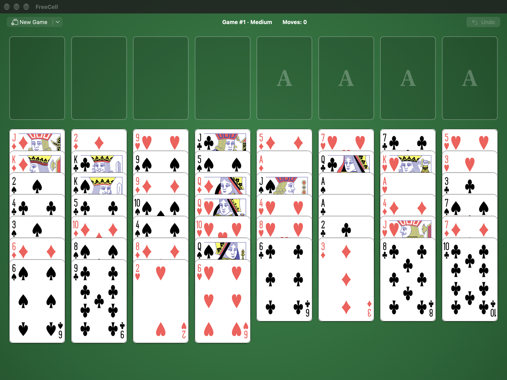

<p align="center">
  <a href="LICENSE"></a>
</p>

# FreeCell

> _Classic FreeCell solitaire for iPad, iPhone and Mac. No ads, no purchases._

<p align="center">
  
</p>

FreeCell is a SwiftUI app that plays the standard FreeCell game from
[Wikipedia](https://en.wikipedia.org/wiki/FreeCell): four free cells, four foundations and
eight columns, built down in alternate colours. It is for people who want to play FreeCell
without the ads and in-app purchases of the App Store versions. The game numbers use the
Microsoft deal algorithm, so "Game #617" is the same deal as in other FreeCell programs.
The app is not on the App Store. You build it from source and install it with Xcode.

<!-- 🖊 TODO: Set project status — delete the others:
> **Status:** Active development.
> **Status:** Stable — the game is complete; only bug fixes are planned.
> **Status:** Personal project — use at your own risk.
-->

---

## Table of Contents

- [Features](#features)
- [Prerequisites](#prerequisites)
- [Installation](#installation)
- [Quick Start](#quick-start)
- [Controls](#controls)
- [Debug launch arguments](#debug-launch-arguments)
- [Known Limitations](#known-limitations)
- [Contributing](#contributing)
- [License](#license)

---

## Features

- **Standard rules, enforced** — the app refuses an illegal move, puts the cards back, and
  shows a short message that tells why (for example, not enough free cells for the sequence).
- **Supermoves** — move a sequence as one move. The largest size is
  (empty free cells + 1) × 2^(empty columns). An empty target column does not count.
- **Safe automatic moves** — a card goes to its foundation by itself when no other card can
  need it.
- **Microsoft deal numbers** — deals 1 to 32000, without the unsolvable deal #11982.
- **Easy, Medium and Hard games** — each deal has a fixed difficulty, from how much work a
  solver needs to solve it. A new game is a random deal of the difficulty you select. The
  default is Easy, and iCloud syncs your selection to your other devices.
- **Undo** for each move, and a confirmation before **New Game** abandons a game in progress.
- **Victory screen** with falling suit symbols.
- **Portrait and landscape** — on a wide, short screen (an iPhone in landscape), the free
  cells and foundations move to the sides, so that the columns have more height.
- **A real Mac app** — the same SwiftUI code runs as a native macOS app, with a resizable
  window and menu bar commands: **New Game** (⌘N), **Undo** (⌘Z) and a **Difficulty** menu.
- **Traditional card art** — English-pattern court cards (CC0).

---

## Prerequisites

- **Xcode**: the project uses Swift 6 and the Xcode 16 project format. It is built and tested
  with Xcode 27.2.
- **Runs on**: iPadOS 17 or iOS 17 or later, on iPad and iPhone, and macOS 14 or later.
- **Apple ID** in Xcode, to sign the app for your own device.

---

## Installation

```sh
git clone https://github.com/PeteRichardson/freecell.git
open freecell/FreeCell.xcodeproj
```

Select the `FreeCell` scheme and your iPad, **My Mac** or a simulator, then press ⌘R.

To install on your own device, select your team under *Signing & Capabilities* for the
`FreeCell` target. The app uses the iCloud key-value store to sync the difficulty setting, so
signing needs a paid Apple Developer Program membership. With a free Apple ID, remove the
iCloud capability (the `CODE_SIGN_ENTITLEMENTS` setting) first: the setting is then kept on
the device only. On iPad and iPhone, the app then stops after 7 days.

Command line:

```sh
# iPad simulator
xcodebuild -project FreeCell.xcodeproj -scheme FreeCell -configuration Release \
  -destination 'platform=iOS Simulator,name=iPad Pro 13-inch (M5)' build

# Mac
xcodebuild -project FreeCell.xcodeproj -scheme FreeCell -configuration Release \
  -destination 'platform=macOS' -allowProvisioningUpdates build
```

---

## Quick Start

The app starts with a new random deal at the selected difficulty (Easy the first time). The
game number, its difficulty and the move count show at the top, for example
"Game #617 · Hard".
The four empty slots on the left are the free cells. The four slots with an "A" are the
foundations, which you build up from ace to king in one suit.

To start, tap the bottom card of a column. The app moves it to the best legal place.
To win, move all 52 cards to the foundations.

On a Mac, the game is in one window. Closing the window quits the app.

<p align="center">
  
</p>

---

## Controls

On a Mac, a click is the same as a tap.

| Input | Effect |
|-------|--------|
| Tap a card | Moves the card, and the cards on it, to the best legal place: a foundation first, then a column, then a free cell |
| Drag a card or sequence | Moves it to the pile below it. A yellow frame shows a legal place to drop. An illegal drop goes back with a message |
| **New Game** (tap) | Starts a new random deal at the selected difficulty. During a game, it asks "Abandon this game?" first |
| **New Game** (touch and hold; on a Mac, the arrow) | Opens a menu to select Easy, Medium or Hard. The current game does not change; the next new game uses the selection |
| **Undo** | Reverses the last move. Not available during automatic moves |

On a narrow screen (iPhone), the **New Game** and **Undo** buttons show only their icons.

On a Mac, the menu bar has the same commands:

| Menu command | Shortcut |
|--------------|----------|
| File > New Game | ⌘N |
| Edit > Undo | ⌘Z |
| Difficulty > Easy, Medium, Hard | — |

---

## Debug launch arguments

Debug builds accept two launch arguments. Set them in the scheme, under *Run > Arguments*.

| Argument | Effect |
|----------|--------|
| `-deal 617` | Starts the given Microsoft deal |
| `-nearlyWon` | Starts a game that wins at once, to show the victory screen |

---

## Known Limitations

- **No saved game**: the app does not save the game. If the app stops, the next launch
  starts a new deal.
- **No statistics, hints or solver**: the app does not count wins and does not suggest moves.
- **No deal selection in the app**: you can choose a deal number only with the `-deal`
  launch argument in a debug build.
- **Not tested on a real iPad or iPhone**: the app is tested in the iPad and iPhone
  simulators and on a Mac.
- **No UI tests on a Mac**: the UI tests are for iPad and iPhone only. On a Mac, run the unit
  tests with `-only-testing:FreeCellTests`.
- **Small cards on iPhone**: eight columns on an iPhone screen give small cards.

<!-- 🖊 TODO: Review and expand. -->

---

## Contributing

```sh
git clone https://github.com/PeteRichardson/freecell.git
cd freecell
xcodebuild -scheme FreeCell -destination 'platform=iOS Simulator,name=iPad Pro 13-inch (M5)' test
```

Or press ⌘U in Xcode. The scheme runs the unit tests (Swift Testing) and the UI tests (XCTest).
On a Mac, run the unit tests only:

```sh
xcodebuild -scheme FreeCell -destination 'platform=macOS' -only-testing:FreeCellTests test
```

| Path | Contents |
| --- | --- |
| `FreeCell/Model/Board.swift` | The rules: legal moves, supermoves, safe automatic moves |
| `FreeCell/Model/Deal.swift` | Microsoft-numbered deals |
| `FreeCell/Model/Difficulty.swift` | The difficulty of each deal, read from `FreeCell/DealDifficulty.txt` |
| `FreeCell/Model/DifficultySetting.swift` | The selected difficulty, synced with iCloud |
| `FreeCell/Model/GameModel.swift` | Game state, undo, automatic moves |
| `FreeCell/Views/GameCommands.swift` | Menu bar commands: New Game, Undo, Difficulty |
| `FreeCell/Views/BoardLayout.swift` | Card positions for each screen size and orientation |
| `FreeCell/Views/` | Other SwiftUI views: drag and drop, victory screen |
| `FreeCellTests/` | Unit tests of the rules, the game model and the layout |
| `FreeCellUITests/` | UI tests: tap, drag, illegal drag, New Game confirmation, landscape |
| `scripts/rate_deals.sh` | Makes `FreeCell/DealDifficulty.txt` again with [Freecell Solver](https://fc-solve.shlomifish.org) (about 1 minute). See the script for its build needs |
| `scripts/make_assets.sh` | Makes the card images from the SVG files (needs `librsvg`: `brew install librsvg`) |

The words the code uses are in [GLOSSARY.md](GLOSSARY.md), and the reasons for the deal
ratings are in [docs/adr](docs/adr).

Please open an issue before you start a large change.

---

## License

The code is licensed under the **MIT License** — see [LICENSE](LICENSE) for details.

The card images are the "English pattern" playing cards by Dmitry Fomin, from
[Wikimedia Commons](https://commons.wikimedia.org/wiki/Category:SVG_English_pattern_playing_cards).
They are released under CC0 (public domain).

The deal difficulties come from [Freecell Solver](https://fc-solve.shlomifish.org) by Shlomi
Fish (MIT License), which `scripts/rate_deals.sh` runs. The app does not contain the solver.
