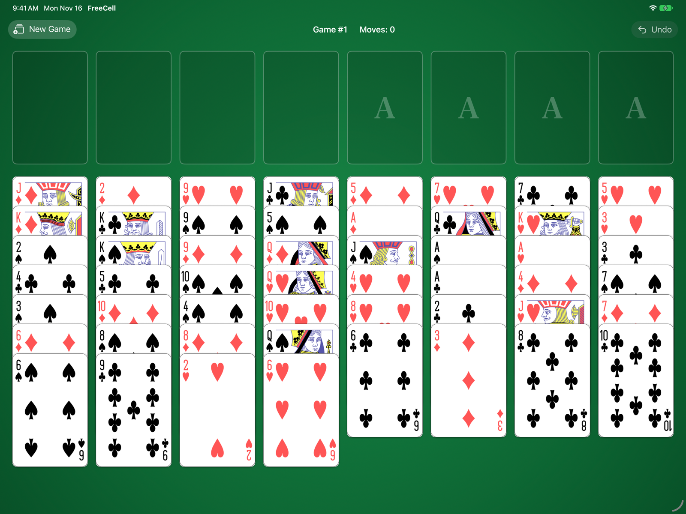

<p align="center">
  <a href="LICENSE"></a>
</p>

# FreeCell

> _Classic FreeCell solitaire for iPad and iPhone. No ads, no purchases._

<p align="center">
  
</p>

FreeCell is a SwiftUI app that plays the standard FreeCell game from
[Wikipedia](https://en.wikipedia.org/wiki/FreeCell): four free cells, four foundations and
eight columns, built down in alternate colours. It is for people who want to play FreeCell
without the ads and in-app purchases of the App Store versions. The game numbers use the
Microsoft deal algorithm, so "Game #617" is the same deal as in other FreeCell programs.
The app is not on the App Store. You build it from source and install it with Xcode.

<!-- 🖊 TODO: Set project status — delete the others:
> **Status:** Active development.
> **Status:** Stable — the game is complete; only bug fixes are planned.
> **Status:** Personal project — use at your own risk.
-->

---

## Table of Contents

- [Features](#features)
- [Prerequisites](#prerequisites)
- [Installation](#installation)
- [Quick Start](#quick-start)
- [Controls](#controls)
- [Debug launch arguments](#debug-launch-arguments)
- [Known Limitations](#known-limitations)
- [Contributing](#contributing)
- [License](#license)

---

## Features

- **Standard rules, enforced** — the app refuses an illegal move, puts the cards back, and
  shows a short message that tells why (for example, not enough free cells for the sequence).
- **Supermoves** — move a sequence as one move. The largest size is
  (empty free cells + 1) × 2^(empty columns). An empty target column does not count.
- **Safe automatic moves** — a card goes to its foundation by itself when no other card can
  need it.
- **Microsoft deal numbers** — deals 1 to 32000, without the unsolvable deal #11982.
- **Undo** for each move, and a confirmation before **New Game** abandons a game in progress.
- **Victory screen** with falling suit symbols.
- **Portrait and landscape** — on a wide, short screen (an iPhone in landscape), the free
  cells and foundations move to the sides, so that the columns have more height.
- **Traditional card art** — English-pattern court cards (CC0).

---

## Prerequisites

- **Xcode**: the project uses Swift 6 and the Xcode 16 project format. It is built and tested
  with Xcode 27.2.
- **Runs on**: iPadOS 17 or iOS 17 or later, on iPad and iPhone.
- **Apple ID** in Xcode, to sign the app for your own device.

---

## Installation

```sh
git clone https://github.com/PeteRichardson/freecell.git
open freecell/FreeCell.xcodeproj
```

Select the `FreeCell` scheme and your iPad (or a simulator), then press ⌘R.

To install on your own device, select your team under *Signing & Capabilities* for the
`FreeCell` target. With a free Apple ID the app stops after 7 days, and you must install it
again from Xcode. With a paid developer account it works for one year.

Command line (simulator build):

```sh
xcodebuild -project FreeCell.xcodeproj -scheme FreeCell -configuration Release \
  -destination 'platform=iOS Simulator,name=iPad Pro 13-inch (M5)' build
```

---

## Quick Start

The app starts with a new random deal. The game number and the move count show at the top.
The four empty slots on the left are the free cells. The four slots with an "A" are the
foundations, which you build up from ace to king in one suit.

To start, tap the bottom card of a column. The app moves it to the best legal place.
To win, move all 52 cards to the foundations.

---

## Controls

| Input | Effect |
|-------|--------|
| Tap a card | Moves the card, and the cards on it, to the best legal place: a foundation first, then a column, then a free cell |
| Drag a card or sequence | Moves it to the pile below it. A yellow frame shows a legal place to drop. An illegal drop goes back with a message |
| **New Game** | Starts a new random deal. During a game, it asks "Abandon this game?" first |
| **Undo** | Reverses the last move. Not available during automatic moves |

On a narrow screen (iPhone), the **New Game** and **Undo** buttons show only their icons.
The app has no keyboard shortcuts.

---

## Debug launch arguments

Debug builds accept two launch arguments. Set them in the scheme, under *Run > Arguments*.

| Argument | Effect |
|----------|--------|
| `-deal 617` | Starts the given Microsoft deal |
| `-nearlyWon` | Starts a game that wins at once, to show the victory screen |

---

## Known Limitations

- **No saved game**: the app does not save the game. If iOS stops the app, the next launch
  starts a new deal.
- **No statistics, hints or solver**: the app does not count wins and does not suggest moves.
- **No deal selection in the app**: you can choose a deal number only with the `-deal`
  launch argument in a debug build.
- **Simulator only**: the app is tested in the iPad and iPhone simulators, not on a real device.
- **Small cards on iPhone**: eight columns on an iPhone screen give small cards.

<!-- 🖊 TODO: Review and expand. -->

---

## Contributing

```sh
git clone https://github.com/PeteRichardson/freecell.git
cd freecell
xcodebuild -scheme FreeCell -destination 'platform=iOS Simulator,name=iPad Pro 13-inch (M5)' test
```

Or press ⌘U in Xcode. The scheme runs the unit tests (Swift Testing) and the UI tests (XCTest).

| Path | Contents |
| --- | --- |
| `FreeCell/Model/Board.swift` | The rules: legal moves, supermoves, safe automatic moves |
| `FreeCell/Model/Deal.swift` | Microsoft-numbered deals |
| `FreeCell/Model/GameModel.swift` | Game state, undo, automatic moves |
| `FreeCell/Views/BoardLayout.swift` | Card positions for each screen size and orientation |
| `FreeCell/Views/` | Other SwiftUI views: drag and drop, victory screen |
| `FreeCellTests/` | Unit tests of the rules, the game model and the layout |
| `FreeCellUITests/` | UI tests: tap, drag, illegal drag, New Game confirmation, landscape |
| `scripts/make_assets.sh` | Makes the card images from the SVG files (needs `librsvg`: `brew install librsvg`) |

Please open an issue before you start a large change.

---

## License

The code is licensed under the **MIT License** — see [LICENSE](LICENSE) for details.

The card images are the "English pattern" playing cards by Dmitry Fomin, from
[Wikimedia Commons](https://commons.wikimedia.org/wiki/Category:SVG_English_pattern_playing_cards).
They are released under CC0 (public domain).
